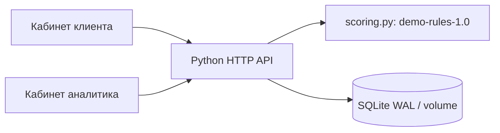
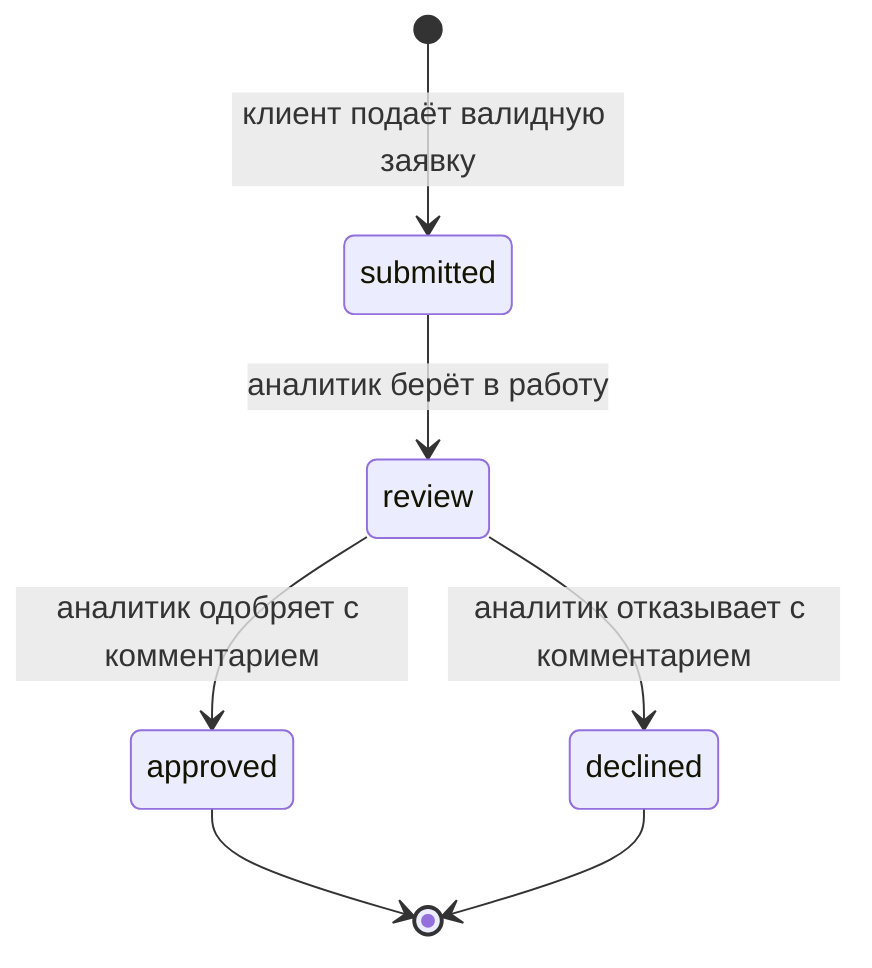

# Архитектура и модель процесса

Рекомендация approve/review/decline не является состоянием заявки. При подаче сохраняются submitted, рассчитанная рекомендация и событие. Только банковская роль переводит в review и принимает финальное решение. Обход рекомендации разрешён как ручное решение с обязательным комментарием; отдельной политики override пока нет.

## Данные

| Сущность | Поля | Связи |
|---|---|---|
| applications | id, owner, data (JSON), status, assessment (JSON), created_at | owner — демо-логин из конфигурации |
| events | id, application_id, actor, status, comment, created_at | application_id → applications.id |
| Session (в памяти) | случайный token → username, expires_at | демо-пользователь |

`data`: company, amount, term_months, monthly_revenue, monthly_expenses, existing_payment, business_months. `assessment`: policy_version, recommendation, reasons, monthly_payment, coverage, annual_rate, free_cash. Отдельная таблица клиентов и реальные персональные данные отсутствуют.

## Решение

Аннуитетный платёж при синтетической годовой ставке 24%. Свободный поток = выручка − расходы. Покрытие = свободный поток / (новый платёж + существующие платежи).

- decline: поток неположительный, покрытие < 1 или возраст бизнеса < 6 месяцев;
- review: иначе покрытие < 1,3 или возраст < 12 месяцев;
- approve: остальные случаи.

Это прозрачный baseline, не вероятность дефолта. Учёт сезонности, налогов, достоверности документов, отрасли и кредитной истории отсутствует. Руслану следует валидировать определения выручки/расходов и не допускать двойного учёта долгового обслуживания.

## Надёжность

Создание заявки/события и переход статуса/события атомарны. BEGIN IMMEDIATE сериализует конкурирующие решения; второй несовместимый переход получает 409. Валидация проверяет границы, типы, NaN/Infinity и целочисленные сроки. Зависимости runtime — только stdlib. Копии БД, мониторинг, миграции и горизонтальное масштабирование — дальнейшая работа. При росте нагрузки — PostgreSQL, устойчивые сессии, production web server и управляемая авторизация; микросервисы на этом этапе не нужны.
